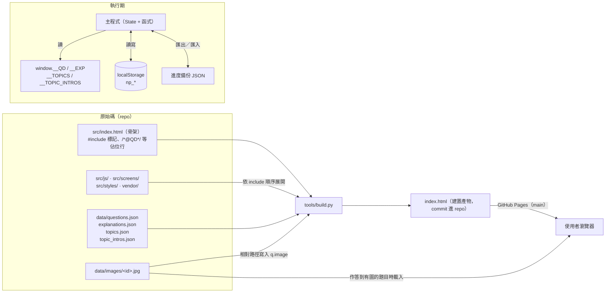
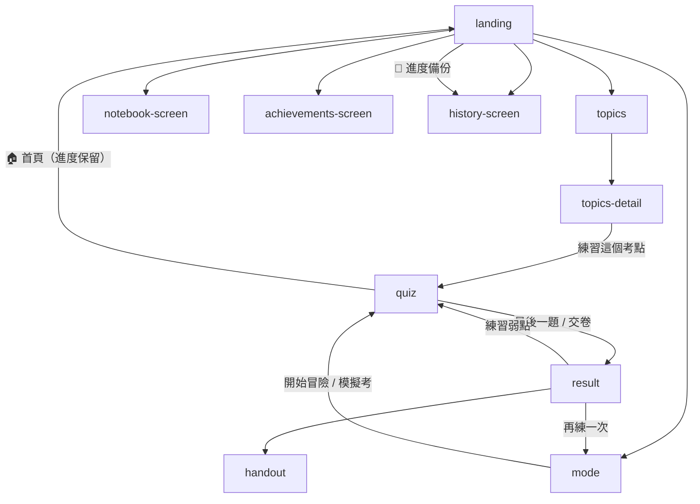

# 系統架構

> 適用版本：分支 `claude/confident-cray-stta0j`（原始碼拆檔後）。原始碼在 `src/`（約 50 個檔案、5,600 行，不含第三方函式庫），建置產物 `index.html` 約 4.7 MB（gzip 後約 1.6 MB），附圖另存 `data/images/`（約 1.6 MB）。
> 本文不再標註行號（每次修改都會位移），請以函式名稱搜尋。

## 1. 架構總覽

使用者拿到的是 **一個 `index.html` 加上附圖資料夾 `data/images/`**：函式庫、字型、題庫、詳解、程式碼全部內嵌，附圖以相對路徑載入（只有作答到有圖的題目才下載），沒有後端、沒有對其他網域的請求。需要完全單檔時可用 `build.py --embed-images` 產生附圖也內嵌的離線檔。原始碼拆成「骨架 + 程式／畫面／樣式檔 + 資料檔」，由建置腳本組合：



工具：

| 檔案 | 用途 |
|---|---|
| `tools/build.py` | 遞迴展開 `src/index.html` 的 include 標記（`vendor/` 從 repo 根目錄、其餘從 `src/` 解析），再把四個佔位行換成 `window.__XX=<JSON>;`；題目若有 `data/images/<id>.jpg` 就加上 `image` 欄位（預設為相對路徑，`--embed-images [輸出檔]` 時為 data URI，輸出到不進版控的 `np-quiz-offline.html`）；`--check` 只比對 `index.html` 是否為最新 |
| `tools/validate.py` | 題庫一致性檢查（題號完整、選項 A–D、答案格式、標籤、附圖、詳解 ✅ 與答案一致、考點引用） |
| `tools/refresh_topics.py` | 依 `qids` 重算考點 `count`／`stars`／`years`，並同步講義摘要中的「N星，N題」 |
| `tools/import_exam.py` | `fetch`／`import`／`apply`／`verify`：從衛福部公告 PDF 匯入新年度試卷（解析、核對答案、裁圖、產生待補詳解清單），或核對既有試卷 |
| `.github/workflows/validate.yml` | push 到 `main` 與 PR 時執行 `validate.py`、`build.py --check`（`validate` job）與端對端測試（`e2e` job） |
| `tests/e2e.mjs` | `npm test`：以 Playwright + Chromium 開啟建置後的 `index.html`，驗證判分、回顧、模擬考、id 轉換、XSS、儲存空間不足、進度備份等主要流程 |
| `tests/visual.mjs` | `npm run visual`：固定亂數、時間與作答紀錄，截下 78 個畫面（手機／桌機 × 主要畫面，加 6 套主題）與 `.visual/baseline/` 逐像素比較，用於確認重構或樣式調整沒有改變畫面 |

設計取捨：

| 決策 | 好處 | 代價 |
|---|---|---|
| 產物為單檔、內嵌所有文字資料，附圖獨立 | `file://` 直接可用、部署零設定；首次載入少了約 1.6 MB 附圖 | 檔案 ~4.7 MB；`index.html` 的 diff 無法閱讀（請看 `data/`、`src/` 的 diff）；完全離線需另產 `--embed-images` 版本 |
| 原始碼拆檔、建置時合併 | 每個畫面的程式／HTML／樣式可分開閱讀與 review；產物仍是單檔 | 改任何檔案都要重新建置；檔案之間靠全域名稱溝通，沒有 import 關係可追 |
| 資料拆成一行一題的 JSON | diff 可讀、可用腳本驗證 | 改資料後必須重新建置並一併 commit `index.html`（CI 會檢查） |
| 無框架、全域函式 + inline `onclick` | 零執行期依賴、零執行期建置 | 無模組邊界、命名空間污染；以瀏覽器端對端測試（`tests/e2e.mjs`）代替單元測試 |
| `localStorage` 存全部進度 | 免帳號、免後端 | 不能自動跨裝置同步（需手動「進度備份」匯出／匯入）；清除瀏覽器資料即遺失；~5 MB 配額上限（寫入經 `safeSet()`，失敗不中斷流程） |

## 2. 原始碼檔案地圖

`src/index.html` 只是骨架，依序 include 以下檔案（順序即建置後在頁面中的順序；CSS 的覆寫關係與 JS 的頂層執行順序都依賴這個順序，新增檔案時請放在對應位置）：

| 區段 | 檔案 | 內容 |
|---|---|---|
| `<head>` 函式庫 | `vendor/chart.umd.min.js`、`marked.umd.js`、`purify.min.js` | Chart.js v4.4.0（UMD）、marked v15.0.7、DOMPurify 3.2.6 |
| 主要 `<style>` | `styles/fonts.css` → `base.css` → `buttons.css` → `landing.css` → `mode.css` → `quiz.css` → `result.css` → `toast.css` → `handout.css` → `animations.css` → `print.css` → `notebook.css` → `topics.css` → `responsive.css` → `themes/*.css` | 內嵌字型（base64 woff2）→ **Design Tokens**（`:root`，在 `base.css`）→ 各畫面元件樣式 → RWD → 6 個主題覆寫（`body.theme-*`） |
| `<body>` 靜態 DOM | `screens/common.html`、`landing`、`topics`、`mode`、`quiz`、`result`、`handout`、`achievements`、`history`、`notebook.html` | Toast 容器、星空 canvas、附圖放大層，以及 10 個畫面 |
| **資料區** | 佔位行 | `/*@QD*/`、`/*@EXP*/`、`/*@TOPICS*/`、`/*@TOPIC_INTROS*/`，建置時換成資料（見 [DATA_SCHEMA.md](DATA_SCHEMA.md)） |
| **主程式**（`'use strict'`） | `js/state.js` → `storage.js` → `srs.js` → `screens.js` → `mode.js` → `quiz.js` → `explanation.js` → `result.js` → `achievements.js` → `handout.js` → `ui.js` → `exam.js` → `focus.js` → `swipe.js` → `boot.js` | State 與常數、初始化與 id 遷移、SRS、畫面切換、模式選擇、答題、詳解、結果、成就、講義、Toast／附圖放大／`md()`、模擬考、弱點加強、鍵盤／滑動、啟動 |
| **擴充功能** | `js/extras.js` → `topics.js` → `notebook.js` → `backup.js` → `starfield.js` | 結果分頁、成就廳、練習紀錄趨勢圖；考點分析；筆記本；進度備份；背景星空動畫 |
| 主題切換器 | `screens/theme-switcher.html`、`styles/theme-switcher.css`、`js/theme.js` | 作答畫面會隱藏，避免壓到按鈕 |

樣式的歸屬原則：class 放在產生它的程式所屬的樣式檔。例如結果頁「本次弱點」由 `focus.js` 產生，樣式在 `mode.css` 的「弱點加強」區段；詳解卡片由 `explanation.js` 產生，樣式在 `quiz.css`。

## 3. 畫面（Screen）與導覽

所有畫面都是 `<div id="screen-{name}" class="screen">`，`showScreen(name)` 移除所有 `.active` 再加到目標上——是一個極簡的 hash-less router。

| `name` | 用途 | 進入時呼叫的渲染函式 |
|---|---|---|
| `landing` | 首頁統計、兩大入口 | `updateLandingStats()` |
| `topics` | 考點總覽（18 科卡片；總題數動態顯示） | `renderTopicsOverview()` |
| `topics-detail` | 單科考點清單 + 主題講義 | `renderTopicDetail(tag)` |
| `mode` | 模式／篩選／題數／詳解時機；模擬考的年度與科目 | `initModeScreen()` |
| `quiz` | 答題 HUD、題卡、詳解面板（一般練習與模擬考共用） | `renderQuestion()` |
| `result` | 成績分頁（含本次弱點、模擬考判定）+ 詳解分頁 | `renderResult()`、`switchResultTab()` |
| `handout` | 個人化講義（可列印） | `generateHandout()` |
| `achievements-screen` | 成就廳 | `renderAllAchievements()`（`showScreen` 進入時自動呼叫） |
| `history-screen` | 進度備份卡片（`#backup-card`）、練習紀錄 + 趨勢圖 | `renderHistory()`（同上） |
| `notebook-screen` | 筆記本 | `renderNotebook()` |



`showScreen` 本身在進入成就廳／紀錄頁時呼叫對應的渲染函式（不再於 `DOMContentLoaded` 覆寫）。

## 4. 全域狀態 `State`

唯一的 runtime 狀態容器（非 reactive，改完要手動呼叫 render）。

| 欄位 | 型別 | 說明 |
|---|---|---|
| `allQuestions` | `Question[]` | 題庫（來自 `window.__QD.questions`） |
| `sessionQuestions` | `Question[]` | 本次練習的題目（模擬考依原卷題號排序） |
| `currentIndex` | `number` | 目前題目索引 |
| `userAnswers` | `Answer[]` | **依題目位置存放**：`userAnswers[i] = { qId, q, selected, correct, timeUsed }`；未作答為空位，請用 `answeredList()` 取得已作答紀錄 |
| `streak` / `maxStreak` | `number` | 連對數 |
| `timerInterval` / `timeLeft` | `number` | 一般練習每題 `QUESTION_SECONDS`（60）秒倒數；模擬考共用 `timerInterval` 做整場倒數 |
| `sessionStart` | `number` | epoch ms |
| `mode` | `'mixed'\|'year'\|'subject'\|'weak'\|'srs'\|'exam'\|'focus'\|'topic'` | 練習模式（`focus` = 弱點加強、`topic` = 考點練習） |
| `selectedYears` / `selectedExamTypes` / `selectedTags` | `array` | 篩選條件 |
| `selectedCount` | `number` | 題數；「全部」以 `9999` 表示 |
| `explainMode` | `'immediate'\|'deferred'` | 詳解時機 |
| `examYear` / `examType` | `number` / `string` | 模擬考選擇（runtime 才加上的欄位） |
| `exam` | `{ year, examType, deadline, picks } \| null` | 進行中的模擬考；`picks[i]` 為第 i 題目前選的字母，`deadline` 為交卷期限（epoch ms） |
| `lastExam` | `{ year, examType, score, blank }` | 最近一次交卷結果，供結果頁判定 |
| `progress` | `Progress` | 長期進度（持久化，見 DATA_SCHEMA） |
| `achievements` | `object` | 已解鎖成就 `{ key: { date } }` |
| `newlyUnlocked` | `string[]` | 本次新解鎖（runtime 才加上的欄位） |

常數：`QUESTION_SECONDS = 60`、`SUBJECT_CATEGORIES`（4 類 18 科）、`ACHIEVEMENTS`（12 個成就）、`SRS_INTERVALS`、`EXAM_MINUTES = 90`、`EXAM_PAIRS`（通論 ↔ 進階內／外科）、`BACKUP_KEYS`／`BACKUP_JSON_KEYS`（進度備份）。

## 5. 核心流程

### 5.1 啟動

```
DOMContentLoaded → init()
  ├ marked.use({ breaks: true })   詳解中單一換行即換行（選項分析一行一個選項）
  ├ 註冊 keydown（handleQuizKeys）、touchstart/touchend（滑動切題）、附圖點擊放大
  ├ loadProgress()                 讀 np_progress / np_achievements，再 migrateQuestionIds()（含清除舊版 np_api_key、np_exp_*）
  ├ loadQuestions()                優先 window.__QD；否則 fetch('./data/questions.json')
  ├ updateLandingStats()
  └ loadSavedSession()             有 np_session → confirm() 是否續做 → restoreSession()
```

`migrateQuestionIds()`：題庫整理時移除了重複匯入的 id 1433–1918（與 1–486 相同）以及誤收的考卷說明。載入時把 `srs`、`firstCorrect`、`lastAnswered` 與筆記中的舊 id 轉到保留的題目（`removedQuestionId()`），考卷說明的紀錄直接刪除。**新題目不可再使用這些 id。**

### 5.2 出題（`startSession` → `beginSession`）

| 模式 | 題目池 |
|---|---|
| `mixed` | 年份 ∩ 考試類型 ∩ 科別（任一 tag 命中即可）；未選 = 不篩 |
| `year` | 年份 ∩ 考試類型 |
| `subject` | 科別 |
| `weak` | `progress.lastAnswered[id].correct === false`（最近一次答錯） |
| `srs` | `getSRSQueue(n)`，**不洗牌**，依熟練度由低到高 |
| `exam` | 單一年度 × 單一科目的 80 題，依原卷題號排序，建立 `State.exam` |

非 SRS、非模擬考：Fisher–Yates `shuffle()` 後取前 N 題。`beginSession(pool)` 統一重設本次狀態（非模擬考時清除 `State.exam`）。

另外兩個入口直接組題目池：

- 考點練習 `startTopicPractice()`：以 `__TOPICS[tag][topic].qids` 建立題目池，`mode = 'topic'`（會清除殘留的模擬考狀態）。
- 弱點加強 `startFocusPractice(tags)`：該科別的題目依「最近答錯 → 沒做過 → 答對過」排序，取 20 題，`mode = 'focus'`。

### 5.3 作答（一般練習）

```
renderQuestion()
  ├ 已有 userAnswers[currentIndex] → 一律回顧模式（不可重答，顯示詳解）
  └ 否則 startTimer()（QUESTION_SECONDS）
       ├ selectAnswer(letter)
       │    isCorrect() → 視覺回饋 → recordAnswer() → checkAchievements()
       │    → immediate：showExplanation()   deferred：自動 nextQuestion()
       ├ timeUp()          視為答錯，selected = null，timeUsed = QUESTION_SECONDS
       ├ skipQuestion()    該位置尚無紀錄時記為答錯，再跳下一題
       └ prevQuestion()    renderQuestion(true)：回顧模式
```

`recordAnswer(q, selected, correct, timeUsed, index = currentIndex)` 一次更新：`userAnswers[index]`、streak、`progress.totalAnswered/totalCorrect/byTag/byYear/firstCorrect/lastAnswered`、SRS，最後 `saveProgress()` + `saveSession()`（**每題都寫入 localStorage**，因此中途關頁可續做）。所有寫入經 `safeSet()`：空間不足時只提示一次，不中斷作答。

`confirmEnd()`：一題都沒答時詢問是否結束，確認後回首頁、不留成績紀錄；否則以「已作答數」計算剩餘題數並確認交卷。

題幹以 `questionHtml(q)` 渲染：組合題的 ①②③④ 各自換行，若有 `q.image` 則附上 ``（點擊由 `openFigure()` 放大，Esc 或點擊關閉）。作答、講義、延後詳解、考點題目列表共用此函式。

操作輔助：

- 鍵盤（`handleQuizKeys`）：A–D／1–4 作答；詳解顯示時 Enter／→ 下一題；模擬考中 Enter／→ 下一題、← 上一題；Esc 關閉放大圖與題號面板。輸入框中不攔截。
- 滑動（`handleQuizTouchStart/End`）：水平位移 ≥ 70 px、垂直位移不超過水平的 0.6 倍、800 ms 內；右滑上一題，左滑在作答後才下一題（模擬考中隨時可滑）。
- 詳解面板的「寫筆記／下一題」按鈕列（`.explanation-actions`）以 `position: sticky` 固定在畫面底部。

### 5.4 模擬考

```
startSession()（mode = 'exam'）→ State.exam = { year, examType, deadline: now + 90 分, picks: [] }
renderQuestion() → updateExamHud()（「下一題」「🔢 題號」、已答數）→ startExamTimer()（整場倒數）
  ├ selectAnswer → examPick(letter)   只記錄 picks[i]，加 .picked，不顯示對錯、不寫入進度
  ├ 上一題／下一題／滑動／鍵盤 ← →     自由切題；最後一題按下一題會開題號面板
  ├ openExamPalette()                 1–80 題號格，點擊 jumpExamQuestion(i)
  └ confirmEnd() 或時間到 → submitExam()
       有作答的題目 recordAnswer(..., i)；未作答只放進 userAnswers[i]（0 分），不寫入長期紀錄
       score = 答對數 × 1.25；寫入 progress.mockExams；State.lastExam → endSession()
```

`renderExamVerdict()` 在結果頁顯示分數與單科 50 分門檻；若 `progress.mockExams` 中有同年度的另一科（`EXAM_PAIRS`），再依「兩科平均 ≥ 60 且各科 ≥ 50」判定筆試是否及格（平均計算至小數第 2 位，無條件捨去，同簡章）。中途離開時 `State.exam` 隨 `np_session` 保存，續做時以 `deadline` 繼續倒數。

### 5.5 詳解與 Markdown 渲染

全部題目都有內嵌詳解。`showExplanation()`、延後詳解、講義、考點講義與筆記的 Markdown 一律經 `md(text)` 渲染：`DOMPurify.sanitize(marked.parse(text))`。沒有詳解時顯示「此題尚無詳解」。舊版的 Claude API 詳解路徑（API Key、`np_exp_*` 快取）已移除。

### 5.6 結束（`endSession`）

清除 `np_session` → 以 `answeredList()` 計算本次成績與各科正確率 → `progress.sessions.unshift(...)`（保留最近 20 筆）→ 渲染分數、等級（`getRank`：≥95/85/75/60）、新成就（`checkAchievements` 在每題作答後判定，條件見 KNOWN_ISSUES #6）、本次弱點（`renderSessionWeak`：本次正確率最低 3 科，每科至少 2 題，附「練習」與「一鍵練習弱點」）、雷達圖、累計弱點（`total ≥ 3` 且正確率 < 80%，最多 5 科，可直接練習）、模擬考判定。

## 6. 核心演算法

### 6.1 SRS 間隔重複

簡化版 Leitner：

```
SRS_INTERVALS = [0, 1, 3, 7, 14, 30]   // 天，index = level
答對：level = min(level + 1, 5)
答錯：level = max(level - 1, 0)        // 只降一級，不歸零
nextReview = now + SRS_INTERVALS[level] * 86400000
```

- 只有**答過的題目**才會有 SRS 紀錄；從未作答的題目不會進入智慧複習。
- 佇列：`nextReview <= now && level < 5`，依 level 升序，上限為所選題數（選「全部」時固定 40）。
- level 5 = 「已掌握」，永遠不再排入。

### 6.2 判分（`isCorrect`）

`answer` 欄位可能是 `"C"`、多選 `"C、D"`（全形頓號分隔，官方更正為「C 或 D 皆給分」）或 `"送分"`。選到正確答案中**任一個**即算對；`"送分"` 只要有作答就算對。

### 6.3 考點星等

由 `tools/refresh_topics.py` 依 `qids` 數量計算：★5 ≥15 題、★4 8–14、★3 4–7、★2 2–3、★1 1 題。

### 6.4 進度備份

`exportBackup()` 讀取 `BACKUP_KEYS`（`np_progress`、`np_achievements`、`np_notes`、`np_explain_mode`、`np_theme`）原始字串，包成 `{ app: 'np-quest', version: 1, exportedAt, data }` 下載。`importBackup()` 驗證 `app`、每個鍵都在 `BACKUP_KEYS` 內、值為字串、`BACKUP_JSON_KEYS` 可解析、`np_progress.totalAnswered` 為數字；顯示備份時間與累計題數並確認後，以 `safeSet()` 寫入檔案中有的鍵、清除未完成快照並重新載入（載入時 `migrateQuestionIds()` 會處理舊備份中已移除的 id）。格式見 [DATA_SCHEMA.md](DATA_SCHEMA.md) §2.5。

## 7. 函式索引

| 模組 | 函式 |
|---|---|
| 啟動／持久化 | `init`、`safeSet`、`saveSession`、`loadSavedSession`、`clearSavedSession`、`restoreSession`、`loadQuestions`、`loadProgress`、`removedQuestionId`、`migrateQuestionIds`、`initProgress`、`saveProgress` |
| SRS | `updateSRS`、`getSRSQueue`、`getSRSStats` |
| 路由／錯誤 | `showScreen`、`showError` |
| 模式選擇 | `initModeScreen`、`renderCategoryBtns`、`selectCategory`、`setExplainMode`、`selectMode`、`updateModeUI`、`toggleYear`、`toggleTag`、`toggleExamType`、`selectCount`、`pickExamOption`、`startSession`、`beginSession` |
| 答題 | `renderQuestion`、`questionHtml`、`startTimer`、`updateTimerBar`、`timeUp`、`selectAnswer`、`isCorrect`、`answeredList`、`recordAnswer`、`nextQuestion`、`prevQuestion`、`skipQuestion`、`exitToHome`、`confirmEnd`、`openFigure`、`handleQuizKeys`、`handleQuizTouchStart`、`handleQuizTouchEnd` |
| 模擬考 | `examPick`、`updateExamHud`、`startExamTimer`、`openExamPalette`、`closeExamPalette`、`jumpExamQuestion`、`submitExam`、`renderExamVerdict` |
| 詳解 | `renderDeferredExplanations`、`showExplanation`、`hideExplanation`、`md` |
| 結果 | `endSession`、`renderResult`、`getRank`、`renderNewAchievements`、`renderRadar`、`renderSessionWeak`、`renderWeakAnalysis`、`startFocusPractice`、`switchResultTab` |
| 成就 | `checkAchievements`、`renderAllAchievements` |
| 講義 | `generateHandout`、`renderWeakSummaryForHandout`、`renderHandoutQuestion` |
| 紀錄 | `renderHistory`、`renderTrendChart` |
| 考點分析 | `renderTopicsOverview`、`showTopicDetail`、`renderTopicDetail`、`startTopicPractice` |
| 筆記本 | `loadNotes`、`saveNotes`、`toggleNotePanel`、`saveCurrentNote`、`updateNoteIndicator`、`renderNotebook`、`deleteNote`、`exportNotes`、`importNotes` |
| 進度備份 | `exportBackup`、`importBackup`、`downloadJson` |
| 主題 | `applyTheme`、`window.setTheme`、`window.toggleThemeMenu` |
| 工具 | `showToast`、`shuffle`、`setEl`、`setStyle` |
