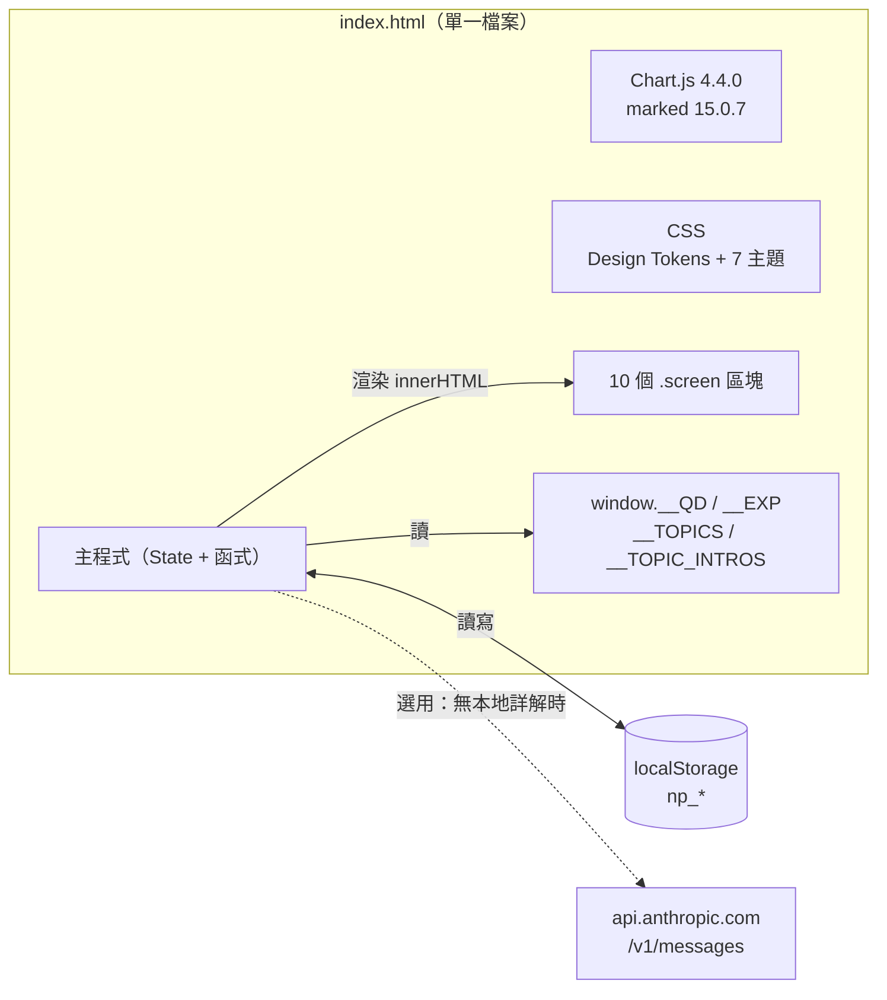
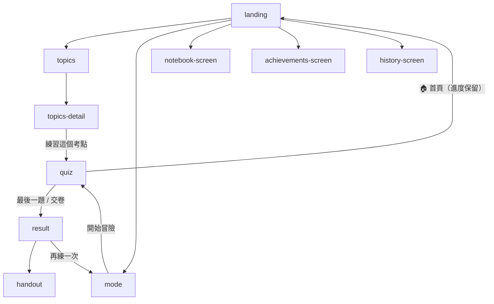

# 系統架構

> 適用版本：commit `278bf3d`（`index.html` 共 4,613 行、約 4.98 MB）。
> 文中 `index.html:NNNN` 為行號，修改檔案後行號會位移，請以函式名稱搜尋為準。

## 1. 架構總覽

整個應用是 **一個自給自足的 `index.html`**：函式庫、字型、題庫、詳解、程式碼全部內嵌，沒有建置工具、沒有後端、沒有外部請求（唯一例外是選用的 Claude API 詳解）。



設計取捨：

| 決策 | 好處 | 代價 |
|---|---|---|
| 單檔內嵌所有資料 | `file://` 直接可用、離線可用、部署零設定 | 檔案 ~5 MB；改題庫要重新產出整個 HTML；diff 難讀 |
| 無框架、全域函式 + inline `onclick` | 零依賴、零建置 | 無模組邊界、命名空間污染、難以單元測試 |
| `localStorage` 存全部進度 | 免帳號、免後端 | 不能跨裝置同步；清除瀏覽器資料即遺失；~5 MB 配額上限 |

## 2. `index.html` 區段地圖

| 行號範圍 | 內容 |
|---|---|
| 1–6 | `<head>`、`<title>` |
| 7–27 | Chart.js v4.4.0（UMD，壓縮，內嵌） |
| 28–34 | marked v15.0.7（Markdown parser，內嵌） |
| 35–2182 | 主要 `<style>` |
| ├ 36–94 | 內嵌字型（Press Start 2P、Share Tech Mono，base64 woff2） |
| ├ 100–210 | **Design Tokens**（`:root` CSS 變數） |
| ├ 211–1301 | 元件樣式（按鈕、Landing、HUD、題卡、結果、講義、Toast、動畫、`@media print`、筆記本、考點表格） |
| ├ 1302–1339 | RWD（`max-width: 768px` / `480px`） |
| └ 1340–2182 | 6 個主題覆寫（`body.theme-*`） |
| 2184–2572 | `<body>` 靜態 DOM：Toast 容器、星空 canvas、10 個畫面 |
| 2573–2578 | **資料區**：第 2574–2577 行各為一個超長 JSON 賦值（見 [DATA_SCHEMA.md](DATA_SCHEMA.md)） |
| 2579–3860 | **主程式**：State、初始化、模式、答題、詳解、SRS、結果、成就、講義、工具函式 |
| 3861–4542 | **擴充功能**：結果分頁、成就廳、練習紀錄趨勢圖、考點分析、筆記本、`showScreen` 包裝、星空動畫 |
| 4543–4611 | 主題切換器（DOM + 樣式 + IIFE） |

## 3. 畫面（Screen）與導覽

所有畫面都是 `<div id="screen-{name}" class="screen">`，`showScreen(name)`（`index.html:2815`）移除所有 `.active` 再加到目標上——是一個極簡的 hash-less router。

| `name` | 用途 | 進入時呼叫的渲染函式 |
|---|---|---|
| `landing` | 首頁統計、兩大入口 | `updateLandingStats()` |
| `topics` | 考點總覽（18 科卡片） | `renderTopicsOverview()` |
| `topics-detail` | 單科考點清單 + 主題講義 | `renderTopicDetail(tag)` |
| `mode` | 模式／篩選／題數／詳解時機 | `initModeScreen()` |
| `quiz` | 答題 HUD、題卡、詳解面板 | `renderQuestion()` |
| `result` | 成績分頁 + 詳解分頁 | `renderResult()`、`switchResultTab()` |
| `handout` | 個人化講義（可列印） | `generateHandout()` |
| `achievements-screen` | 成就廳 | `renderAllAchievements()`（由包裝後的 `showScreen` 自動觸發） |
| `history-screen` | 練習紀錄 + 趨勢圖 | `renderHistory()`（同上） |
| `notebook-screen` | 筆記本 | `renderNotebook()` |



`showScreen` 在擴充區的 `DOMContentLoaded`（`index.html:4510`）被包裝一層，以便進入成就廳／紀錄頁時自動渲染。

## 4. 全域狀態 `State`

定義於 `index.html:2596`，是唯一的 runtime 狀態容器（非 reactive，改完要手動呼叫 render）。

| 欄位 | 型別 | 說明 |
|---|---|---|
| `allQuestions` | `Question[]` | 題庫（來自 `window.__QD.questions`） |
| `sessionQuestions` | `Question[]` | 本次練習的題目（已洗牌、已截斷） |
| `currentIndex` | `number` | 目前題目索引 |
| `userAnswers` | `Answer[]` | `{ qId, q, selected, correct, timeUsed }`，依作答順序 push |
| `streak` / `maxStreak` | `number` | 連對數 |
| `timerInterval` / `timeLeft` | `number` | 每題 60 秒倒數 |
| `sessionStart` | `number` | epoch ms |
| `mode` | `'mixed'\|'year'\|'subject'\|'weak'\|'srs'` | 練習模式 |
| `selectedYears` / `selectedExamTypes` / `selectedTags` | `array` | 篩選條件 |
| `selectedCount` | `number` | 題數；「全部」以 `9999` 表示 |
| `explainMode` | `'immediate'\|'deferred'` | 詳解時機 |
| `progress` | `Progress` | 長期進度（持久化，見 DATA_SCHEMA） |
| `achievements` | `object` | 已解鎖成就 `{ key: { date } }` |
| `newlyUnlocked` | `string[]` | 本次新解鎖（runtime 才加上的欄位） |

常數：`SUBJECT_CATEGORIES`（`:2588`，4 類 18 科）、`ACHIEVEMENTS`（`:2619`，12 個成就）、`SRS_INTERVALS`（`:2761`）。

## 5. 核心流程

### 5.1 啟動

```
DOMContentLoaded → init()
  ├ loadProgress()          讀 np_progress / np_achievements
  ├ loadQuestions()         優先 window.__QD；否則 fetch('./data/questions.json')
  ├ updateLandingStats()
  └ loadSavedSession()      有 np_session → confirm() 是否續做 → restoreSession()
```

### 5.2 出題（`startSession`, `:2987`）

| 模式 | 題目池 |
|---|---|
| `mixed` | 年份 ∩ 考試類型 ∩ 科別（任一 tag 命中即可）；未選 = 不篩 |
| `year` | 年份 ∩ 考試類型 |
| `subject` | 科別 |
| `weak` | `progress.lastAnswered[id].correct === false`（最近一次答錯） |
| `srs` | `getSRSQueue(n)`，**不洗牌**，依熟練度由低到高 |

非 SRS 模式：Fisher–Yates `shuffle()` 後取前 N 題。考點練習 `startTopicPractice()`（`:4309`）會繞過 `startSession`，直接以 `__TOPICS[tag][topic].qids` 建立題目池。

### 5.3 作答

```
renderQuestion() → startTimer()（60s）
  ├ selectAnswer(letter)
  │    isCorrect() → 視覺回饋 → recordAnswer() → checkAchievements()
  │    → immediate：showExplanation()   deferred：自動 nextQuestion()
  ├ timeUp()          視為答錯，selected = null，timeUsed = 60
  ├ skipQuestion()    記為答錯後跳下一題
  └ prevQuestion()    renderQuestion(true)：回顧模式，不可重答
```

`recordAnswer()`（`:3373`）一次更新：`userAnswers`、streak、`progress.totalAnswered/totalCorrect/byTag/byYear/firstCorrect/lastAnswered`、SRS，最後 `saveProgress()` + `saveSession()`（**每題都寫入 localStorage**，因此中途關頁可續做）。

### 5.4 詳解來源優先序（`fetchExplanation`, `:3299`）

1. `window.__EXP[id]`（內嵌，目前 1,918/1,918 題皆有）→ `marked.parse()`
2. `localStorage['np_exp_{id}']`（先前 API 回應的 HTML 快取）
3. Claude Messages API（需使用者自行輸入 API Key，存 `np_api_key`）
   - model `claude-haiku-4-5-20251001`、`max_tokens: 400`、header `anthropic-dangerous-allow-browser: true`
   - 由於第 1 層已全覆蓋，**此路徑目前實際上不會被觸發**

### 5.5 結束（`endSession`, `:3484`）

清除 `np_session` → 計算本次各科正確率 → `progress.sessions.unshift(...)`（保留最近 20 筆）→ 渲染分數、等級（`getRank`：≥95/85/75/60）、新成就、雷達圖、累計弱點前 5 科（`total ≥ 3`）。

## 6. 核心演算法

### 6.1 SRS 間隔重複（`:2761–2807`）

簡化版 Leitner：

```
SRS_INTERVALS = [0, 1, 3, 7, 14, 30]   // 天，index = level
答對：level = min(level + 1, 5)
答錯：level = max(level - 1, 0)        // 只降一級，不歸零
nextReview = now + SRS_INTERVALS[level] * 86400000
```

- 只有**答過的題目**才會有 SRS 紀錄；從未作答的題目不會進入智慧複習。
- 佇列：`nextReview <= now && level < 5`，依 level 升序，上限為所選題數（選「全部」時固定 40）。
- level 5 = 「已掌握」，永遠不再排入。

### 6.2 判分（`isCorrect`, `:3366`）

`answer` 欄位可能是 `"C"`、多選 `"C、D"`（全形頓號分隔）或 `"送分"`。目前邏輯：選到正確答案中**任一個**即算對。`"送分"` 的處理有 bug，見 [KNOWN_ISSUES.md](KNOWN_ISSUES.md#bug-1)。

### 6.3 考點星等

由離線管線預先算好寫進 `__TOPICS`（前端只讀），規則見首頁說明：★5 ≥15 題、★4 8–14、★3 4–7、★2 2–3、★1 偶出。

## 7. 函式索引

| 模組 | 函式（行號） |
|---|---|
| 啟動／持久化 | `init` 2635、`saveSession` 2658、`loadSavedSession` 2677、`clearSavedSession` 2688、`restoreSession` 2692、`loadQuestions` 2714、`loadProgress` 2734、`initProgress` 2746、`saveProgress` 2809 |
| SRS | `updateSRS` 2764、`getSRSQueue` 2780、`getSRSStats` 2796 |
| 路由／錯誤 | `showScreen` 2815、`showError` 2824 |
| 模式選擇 | `initModeScreen` 2847、`renderCategoryBtns` 2887、`selectCategory` 2898、`setExplainMode` 2916、`selectMode` 2922、`updateModeUI` 2929、`toggleYear` 2954、`toggleTag` 2963、`toggleExamType` 2972、`selectCount` 2981、`startSession` 2987 |
| 答題 | `renderQuestion` 3039、`startTimer` 3103、`updateTimerBar` 3118、`timeUp` 3132、`selectAnswer` 3154、`isCorrect` 3366、`recordAnswer` 3373、`nextQuestion` 3447、`prevQuestion` 3456、`skipQuestion` 3464、`exitToHome` 3476、`confirmEnd` 3894 |
| 詳解 | `renderDeferredExplanations` 3197、`getApiKey` 3238、`saveApiKey` 3242、`showApiKeyModal` 3246、`showExplanation` 3254、`fetchExplanation` 3299、`hideExplanation` 3361 |
| 結果 | `endSession` 3484、`renderResult` 3532、`getRank` 3557、`renderNewAchievements` 3565、`renderRadar` 3587、`renderWeakAnalysis` 3651、`switchResultTab` 3866 |
| 成就 | `checkAchievements` 3683、`renderAllAchievements` 3900 |
| 講義 | `generateHandout` 3720、`renderWeakSummaryForHandout` 3757、`renderHandoutQuestion` 3781 |
| 紀錄 | `renderHistory` 3914、`renderTrendChart` 3955 |
| 考點分析 | `renderTopicsOverview` 4154、`showTopicDetail` 4191、`renderTopicDetail` 4196、`startTopicPractice` 4309 |
| 筆記本 | `loadNotes` 4332、`saveNotes` 4335、`toggleNotePanel` 4339、`saveCurrentNote` 4354、`updateNoteIndicator` 4379、`renderNotebook` 4389、`deleteNote` 4455、`exportNotes` 4469、`importNotes` 4482 |
| 主題 | `applyTheme` 4584、`window.setTheme` 4592、`window.toggleThemeMenu` 4593 |
| 工具 | `showToast` 3822、`shuffle` 3840、`setEl` 3847、`setStyle` 3852、`escapeHtml` 4463（未被使用） |
| 未接線（dead code） | `renderLibraryOverview` 4016、`showLibraryDetail` 4069、`renderLibraryDetail` 4075、`renderQuickYearBtns` 4139、`quickStart` 4148、`printHandout` 3817 |
